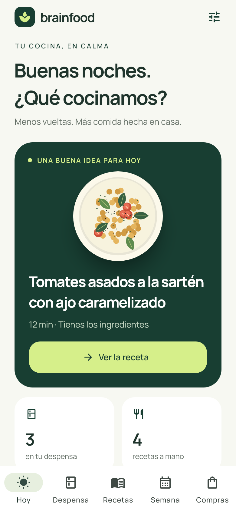
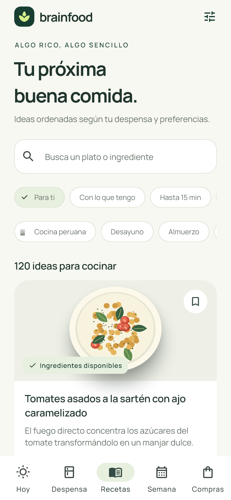
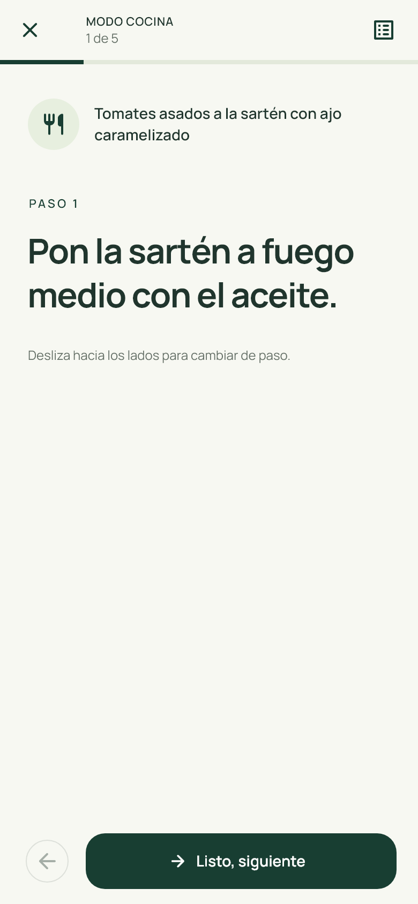

# BrainFood

Aplicación Android en Flutter que convierte lo que tienes en casa en recetas, una lista de compras y un plan semanal práctico.

<p align="center">
  
  
  
</p>

## Qué resuelve

- Organiza una despensa personal y prioriza alimentos por usar.
- Encuentra recetas según los ingredientes disponibles, con 120 recetas locales y filtros de cocina peruana.
- Construye una lista de compras sin duplicados, lista para compartir por WhatsApp.
- Planifica comidas de la semana y cocina con instrucciones grandes, temporizadores y progreso guardado.

## Tecnología

Flutter · Dart · Riverpod · Shared Preferences · Flutter Secure Storage

El recetario local funciona sin IA. El asistente opcional solo se activa si la persona usuaria configura su propia clave de proveedor desde la aplicación.

## Preparar el entorno

Esta guía corresponde al código publicado en este repositorio; las copias de desarrollo pueden tener otra versión.

- Flutter con Dart compatible con `pubspec.yaml` (el código publicado declara Dart `^3.13.2`).
- Android SDK y JDK compatibles con el proyecto Android.
- Emulador o equipo Android para ejecutar la interfaz.
- La clave del proveedor solo es necesaria para el asistente remoto opcional; el recetario local es independiente.

## Ejecutar

```powershell
flutter pub get
flutter analyze
flutter test
flutter run
```

## Organización del código

```text
lib/core/                Utilidades y configuración compartida
lib/data/                Modelos, recetario y servicios de persistencia
lib/presentation/        Pantallas y componentes de interfaz
test/                    Pruebas de dominio, almacenamiento y widgets
design_review/           Imágenes de referencia de la interfaz
```

Las imágenes mostradas arriba pertenecen a `design_review/`; son referencias visuales del repositorio y pueden diferir de una compilación actual. La revisión del 26/10/2026 ejecutó el análisis y las pruebas del código público: análisis sin incidencias y 26 pruebas correctas con Flutter 3.47.6/Dart 3.13.5. Consulta el [entorno, cobertura y límites de la verificación](docs/VALIDATION.md).

## Qué demuestra este proyecto

Modelado de ingredientes y recetas, almacenamiento de preferencias, filtros, listas sin duplicados y validación de respuestas externas. Proyecto personal de portafolio; no se presenta como un sistema empresarial.

## Autoría

Creado y dirigido por [**Joseph Ivan Cachay Vargas**](https://github.com/dzenwertz), fundador de [**RETH**](https://rethagency.web.app/). BrainFood es un proyecto independiente de RETH para portafolio profesional.

© 2026 Joseph Ivan Cachay Vargas / RETH. Todos los derechos reservados. Consulta [NOTICE.md](NOTICE.md).

## Privacidad

No publiques tokens, claves de API, archivos `.env`, configuraciones locales de Android ni claves de firma. Configura las credenciales opcionales desde la aplicación y revisa lo que compartirás con el proveedor antes de usar el asistente remoto.
